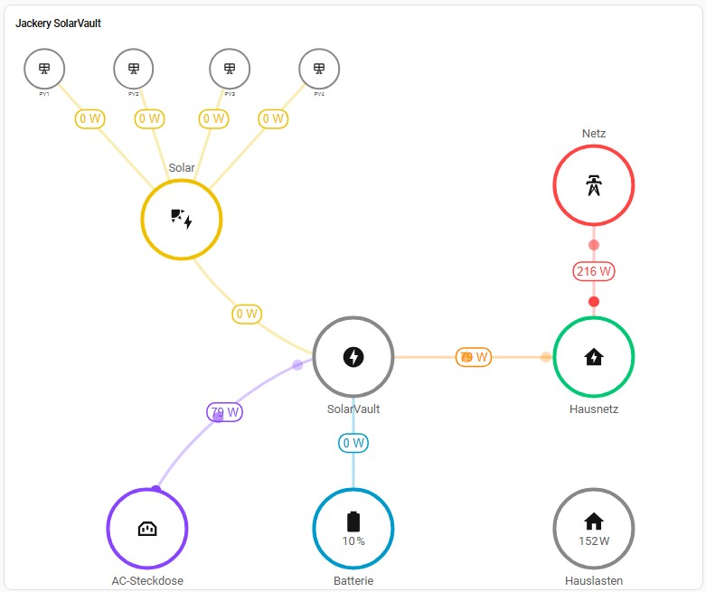

## Jackery SolarVault – Home Assistant Integration (Fork)

[](https://github.com/hacs/integration)
[](https://github.com/csoscd/ha-solarvault/releases)
[](LICENSE)

> **⚠️ This is a fork of the original [Jackery-Official/jackery](https://github.com/Jackery-Official/jackery) integration.**
> 
> This fork adds fixes and additional sensors specifically tested with the **Jackery SolarVault 3 Pro Max**, the **Jackery SmartMeter 3P (HTO907A)** and the **Shelly Pro 3EM** (as Jackery CT sub-device). All credits for the original implementation go to the original authors.
>
> Changes in this fork are tracked in the [commit history](https://github.com/csoscd/ha-solarvault/commits/main). Bug reports and improvements relating to this fork can be filed [here](https://github.com/csoscd/ha-solarvault/issues); for general Jackery integration issues please use the [original repository](https://github.com/Jackery-Official/jackery/issues).

---

## Support me

[](https://ko-fi.com/O5O21U13R9)

---

## Entity Reference

With 109+ entities, finding the right sensor can be tricky.
**[→ docs/entity-reference.md](docs/entity-reference.md)** lists all sensors by category, explains which ones to use for energy dashboards, and explains why SmartMeter sensors are preferred over SolarVault-internal sensors for grid import/export.

Entity IDs follow the pattern:
```
{domain}.jackery_{sn_lowercase}_{entity_display_name_slug}
```
Example: SN `HS2C12600262HH4` → `sensor.jackery_hs2c12600262hh4_solar_power`

---

### Changes vs. the original

#### New sensors (SolarVault 3 Pro Max)

| Sensor | MQTT field | Description |
|---|---|---|
| Inverter Stack Input Power | `stackInPw` | AC power flowing into the inverter stack |
| Inverter Stack Output Power | `stackOutPw` | AC power flowing out of the inverter stack |
| BMS SOC | `soc` | Combined BMS state of charge across all battery units |
| Battery State | `batState` | Current battery operation state (0=transitioning, 1=normal, 2=active) |
| Ethernet Connected | `ethPort` | Whether the Ethernet port is connected |
| WiFi Signal | `wsig` | WiFi signal strength in dBm |
| Max Inverter Standby Power | `maxInvStdPw` | Configured inverter standby power limit |
| Max Grid Standby Power | `maxGridStdPw` | Configured grid standby power limit |
| AC to Grid Energy | `acOtOngridEgy` | Cumulative AC-to-grid energy |
| CT Import Energy | `inCtEgy` | Cumulative system-level CT import energy (added in firmware post-2026-07) |
| CT Export Energy | `outCtEgy` | Cumulative system-level CT export energy (added in firmware post-2026-07) |
| Forced Charging (Switch) | `socForceChg` | See control entities below |
| WiFi SSID | `wname` | SSID of the connected WiFi network (empty when Ethernet is active) |
| WLAN IP | `wip` | IP address of the SolarVault on the WiFi network |
| Ethernet IP | `eip` | Ethernet IP address of the SolarVault |
| Device Capability | `ability` | Capability bitmask – changes value after firmware updates |
| Device Status | `stat` | Device operation status: normal / waiting / alarm / fault / standby / low_power |
| OnGrid Status | `ongridStat` | Grid-tie status: disconnected / connected |
| CT Status | `ctStat` | CT meter connection status: disconnected / connected |
| Grid Meter Link | `gridSate` | Grid meter link health: not_linked / linked |
| Max Feed Grid Power | `maxFeedGrid` | Maximum grid feed-in power reported by the device (from type-106 status) — also writable, see control entities |

#### New control entities (SolarVault 3 Pro Max)

| Entity type | Entity | MQTT field | Range / Options | Description |
|---|---|---|---|---|
| Number | SOC Charge Limit | `socChgLimit` | 50–100 % | Maximum SOC the battery charges to |
| Number | SOC Discharge Limit | `socDischgLimit` | 5–49 % | Minimum SOC the battery discharges to |
| Number | Max Feed-in Power (OnGrid) | `maxOutPw` | 0–2500 W (10 W steps) | Maximum OnGrid feed-in power (Einspeiseleistung). The Jackery app only offers 800/1200/2500 W presets, but live testing confirmed the device accepts and enforces arbitrary 10 W step values. |
| Number | Default Output Power | `defaultPw` | 0–200 W (10 W steps) | Fallback output power for Benutzerdefiniert mode (workModel=4) when no schedule entry is active. App limit: 200 W. Schedule slots (configured in app, cloud-only) can be up to 800 W. |
| Number | Max Grid Feed-In Limit | `maxFeedGrid` | 0–2500 W (10 W steps) | System-level enforced grid feed-in cap. **Distinct from** "Max Feed-In Power" (`maxOutPw`). Confirmed writable via cmd=5 (Issue #11). |
| Switch | Forced Charging | `socForceChg` | on / off | Matches the "Erzwungenes Laden" toggle in the Jackery app. When **off**: grid charging only triggers as an emergency below 2% SOC. When **on**: grid charging triggers as soon as SOC falls below the configured SOC Discharge Limit. |
| Select | Auto Standby Mode | `autoStandby` | invalid / standby / on | Controls auto-standby behaviour |
| Select | Work Mode | `workModel` | Eigenverbrauch / Benutzerdefiniert / Tarifmodus / KI-Modus | Operating mode selector. Note: tariff/schedule configuration and KI strategy selection are cloud-only and not accessible via local MQTT. |
| Switch | Auto Standby Allowed | `isAutoStandby` | on / off | Whether auto-standby is permitted |
| Switch | EPS Switch | `swEps` | on / off | Enable/disable EPS (off-grid) output |
| Switch | Off-Grid Fallback | `offGridDown` | on / off | Enable off-grid fallback mode |
| Switch | Follow Meter Power (Zähler folgen) | `isFollowMeterPw` | on / off | Sub-mode within Benutzerdefiniert (workModel=4): device tracks the SmartMeter to achieve net-zero grid exchange. **Only available when Work Mode = Benutzerdefiniert.** |
| Button | Reboot | – | – | Sends a restart command to the SolarVault (type=1, cmd=5, reboot=1). Useful to restore SmartMeter LAN mode without touching the device or app. |

#### SmartMeter 3P / devType=3 CT devices (HTO907A, Shelly Pro 3EM, and others)

The original integration incorrectly classified devType=3 CT devices as smart plugs instead of CT meters (see [issue #18](https://github.com/Jackery-Official/jackery/issues/18)). This caused the energy flow calculation to receive no CT data at all.

This fork fixes the classification for **all devType=3 devices**, regardless of manufacturer or subType:

| Device | subType | Tested |
|---|---|---|
| Jackery SmartMeter 3P (HTO907A) | 5 | ✅ |
| Shelly Pro 3EM | 2 | ✅ |

Both devices send identical MQTT field names and expose the same **19 sensors**:

| Sensor | MQTT field | Description |
|---|---|---|
| Grid Import Power | `tPhasePw` | Total net grid import power |
| Grid Export Power | `tnPhasePw` | Total net grid export power |
| L1/L2/L3 Import Power | `a/b/cPhasePw` | Per-phase grid import power |
| L1/L2/L3 Export Power | `an/bn/cnPhasePw` | Per-phase grid export power |
| Grid Import Energy | `tPhaseEgy` | Cumulative total grid import energy |
| Grid Export Energy | `tnPhaseEgy` | Cumulative total grid export energy |
| L1/L2/L3 Import Energy | `a/b/cPhaseEgy` | Cumulative per-phase import energy |
| L1/L2/L3 Export Energy | `an/bn/cnPhaseEgy` | Cumulative per-phase export energy |
| Communication Mode | `commMode` | 1 = LAN (local MQTT), 2 = Cloud relay – useful for diagnosing data loss |
| Communication State | `commState` | 1 = online, 0 = offline |
| IP Address | `wip` | IP address of the SmartMeter on the local network |

---

### Features

- **Custom Home Assistant integration** (no YAML entities required)
- **MQTT-based data flow** with a shared `JackeryDataCoordinator`
- Periodic data requests every **10 seconds**
- Real-time **power sensors** (W) and cumulative **energy sensors** (kWh)
- **Battery SoC** in percent with proper scaling
- Ready-to-use example configuration for **Energy Flow Card Plus**

### Prerequisites

Before the integration can receive data, **two things must be in place**:

1. **MQTT broker configured and reachable**
   - A running MQTT broker (e.g. Mosquitto) is required.
   - Home Assistant's built-in **MQTT integration** must be configured to connect to it.
   
   

2. **Device configured via Jackery app**
   - Use the Jackery mobile app (version **≥ 2.0.0**) to connect the device to your MQTT broker.
   - Go to: Device Details → Settings → MQTT
   

---

### Installation via HACS

1. Open HACS → **Integrations** → three dots → **Custom repositories**
2. Add URL: `https://github.com/csoscd/ha-solarvault`, Category: `Integration`
3. Search for **"Jackery SolarVault"** and install
4. Restart Home Assistant
5. Go to **Settings → Devices & Services → Add Integration** → search **"Jackery"**
6. Enter:
   - **Device SN**: your device serial number (visible in the Jackery app)
   - **Token**: your device token (visible in the Jackery app MQTT settings)
   - **Topic Prefix**: `hb` (default)

---

### Dashboard Cards



| Card | Description | Docs |
|---|---|---|
| **ha-freeflow** | Fully customizable flow topology — nodes, positions, colors and flows are all configurable. Shown in the screenshot above. | [docs/custom-card-flow.md](docs/custom-card-flow.md) |
| **Energy Flow Card Plus** | Popular circular flow diagram for solar/grid/battery/home. | [docs/card-energy-flow-plus.md](docs/card-energy-flow-plus.md) |
| **Power Flow Card Plus** | Alternative to Energy Flow Card Plus; use when it shows Wh instead of W. | [docs/card-power-flow-plus.md](docs/card-power-flow-plus.md) |

---

### Troubleshooting

#### SmartMeter 3P: no measurement data (all sensors show 0 W / unavailable)

**Symptom:** SmartMeter power sensors (L1–L3 Import/Export, Grid Import/Export Power) suddenly stop delivering values or show 0 W permanently, even though the SmartMeter appears as available in Home Assistant.

**Root cause: commMode switch from LAN → Cloud**

The SmartMeter HTO907A can switch on its own from local MQTT mode ("LAN") to Jackery Cloud relay mode ("Cloud") — for example after repeated internet outages. In Cloud mode it still reports its device info to the SolarVault, but no measurement data.

**How to identify it:**

1. **HA sensor** `sensor.jackery_<name>_communication_mode` shows `2` instead of `1`
   - `1` = LAN (local MQTT path, measurement data flows normally)
   - `2` = Cloud (measurements are relayed via Jackery cloud, not available in HA)

2. **Jackery app:** The SmartMeter displays "Cloud" instead of "LAN" at the top.

3. **MQTT diagnosis:** The type-101 event contains `"commMode":2` and the measurement fields (`tPhasePw`, `aPhasePw`, etc.) are absent from the body entirely.

**Fix: restart the SolarVault**

Restarting the SolarVault (via the Jackery app or directly on the device) causes the SmartMeter to re-register with the SolarVault and automatically choose the LAN path. After the restart, `communication_mode` should return to `1` and measurement data should resume.

> **Note:** There is no MQTT command to set commMode directly — the mode is decided by the SmartMeter itself and cannot be overridden via MQTT.

---

### Links

- **Original integration**: https://github.com/Jackery-Official/jackery
- **ha-freeflow** (custom flow card): https://github.com/csoscd/ha-freeflow
- **Energy Flow Card Plus**: https://github.com/flixlix/energy-flow-card-plus
- **Power Flow Card Plus**: https://github.com/flixlix/power-flow-card-plus
- **Home Assistant MQTT integration**: https://www.home-assistant.io/integrations/mqtt/

---

### Development

#### Running the tests

```bash
uv sync --group test
uv run pytest tests/ -v
```

Tests cover energy-flow calculation logic, MQTT message routing (regression tests for the CT-cache bug), sensor value transforms, and config flow integration tests (using the real HA test framework). Coverage is reported after every run; the minimum threshold is 30 %.

#### Linting & type checking

```bash
uv sync --group lint
uv run ruff check custom_components/jackery/   # linter + import order
uv run mypy custom_components/jackery/         # type checker
python tools/check_translations.py            # translation completeness
```

#### CI pipeline

Every push and pull request runs three GitHub Actions jobs automatically:

| Job | Checks |
|-----|--------|
| **Lint** | Ruff, mypy, translation completeness (`tools/check_translations.py`) |
| **Tests** | pytest with coverage (`--cov-fail-under=50`) |
| **Validate** | HACS validation, Hassfest validation |

[Dependabot](https://docs.github.com/en/code-security/dependabot) is configured to keep GitHub Actions versions up to date (weekly, Mondays).

---

### What's new in v2.5.3

Fix for SmartMeter entity duplication on every HA restart (issue #25, contributed by @cofade via PR #26):

- **Root cause:** The `_migrate_unique_ids()` migration in `__init__.py` detected sub-device entities by checking for an uppercase character in the serial number. The SmartMeter HTO907A reports its serial in **lowercase** (`ac1518779cb4`), so all 19 SmartMeter entities were misidentified as main-device sensors, their `unique_id` was rewritten to the wrong format, and the integration created duplicates with a `_2` suffix on every restart.
- **Fix:** Sub-devices are now detected via the HA device registry (`identifiers: (jackery, sub_{sn})`) instead of string heuristics. Already-broken `unique_id`s are repaired automatically on the next HA start (older entity wins; duplicates are removed). The migration is idempotent.

**Who is affected:** Users whose SmartMeter serial number is lowercase (HTO907A). If you see sensors ending in `_2` (e.g. `sensor.jackery_smartmeter_ac..._l3_bezugsleistung_2`) alongside unavailable originals, this fix resolves them automatically after the HA restart that applies the update.

---

### What's new in v2.5.2

Two robustness fixes backported from community fork analysis (fred-head fork, PRs #25/#43):

- **CT phase power guard:** `float(a_pw) + float(b_pw)` in the sub_type=3 plug update path now has a `try/except` guard. A non-numeric value from the device no longer crashes the update call for that entity.

- **Reauth lifecycle hardening:** The re-authentication flow is no longer triggered when the coordinator is stopping or already stopped. Uses the modern `entry.async_start_reauth(hass)` API (HA ≥ 2024.x) instead of the manual flow init approach, plus a guard against a missing config entry.

---

### What's new in v2.5.1

Three robustness fixes backported from the community fork analysis:

- **Sub-device poll isolation:** A publish failure for one sub-device category (CTs, SmartMeter 3P, Plugs) no longer prevents the remaining categories from being polled in the same cycle. Previously a single error in the loop silently skipped all remaining devTypes.

- **Firmware version top-level fallback:** `_capture_device_meta` now also reads `softver` from the MQTT message envelope (top level) if it is absent from the message body. Fixes devices that report firmware version outside the standard body field.

- **Options flow reloads integration correctly:** `JackeryOptionsFlowHandler` now inherits from `OptionsFlowWithReload` (HA ≥ 2025.8.0). Changing options (SmartMeter HTTP poll settings) now automatically reloads the integration. Token and topic_prefix changes also trigger a reload, fixing a split-brain where the old coordinator remained subscribed to the stale topic after saving.

---

### What's new in v2.5.0

#### Alert-Topic subscription: `jackery_alert` Home Assistant event

The integration now subscribes to the `hb/device/{SN}/alert` MQTT topic.
Whenever the SolarVault publishes an alert message (fault events, Storm Warning
activation/deactivation, threshold alarms), a `jackery_alert` event is fired on
the Home Assistant event bus — ready to trigger automations without polling.

**Event data fields:**

| Field | Description |
|-------|-------------|
| `device_sn` | Serial number of the reporting device |
| `alert_id` | Numeric alert/alarm code (`alertId`) |
| `record_ts` | Unix timestamp of when the event was recorded (`recordTs`) |
| `status` | Alert status, when present |
| `startTs` | Start timestamp of the alert period, when present |
| `endTs` | End timestamp of the alert period, when present |
| `manual` | Manual trigger flag, when present |

**Example automation trigger:**

```yaml
trigger:
  - platform: event
    event_type: jackery_alert
    event_data:
      device_sn: "YOUR_DEVICE_SN"
```

No new sensors are created — alert messages are transient events, not persistent state. The topic was previously not subscribed at all.

#### Battery sensor scope clarifications (firmware-confirmed)

Firmware reverse-engineering of the SolarVault 3 Pro Max (BEMS0002 / STM32H7) and
the BP2500 BMS (HTP0013-BMS00002 / STM32 Cortex-M) confirmed the following, which
are now reflected in the sensor descriptions:

- **`battery_charge_power` / `battery_discharge_power` (batInPw / batOutPw):** Measure
  the **main SolarVault unit only**. The BP2500 has a separate Coulomb Counter that is
  not exposed as a real-time MQTT field. This explains the 200–300 W divergence observed
  when the BP2500 is actively charging or discharging alongside the main unit. The
  `total_battery_charge_power` / `total_battery_discharge_power` sensors (energy balance)
  remain the correct choice for full-stack power monitoring.

- **BP2500 individual SOC:** The BP2500's per-unit SOC (`tSoc`) is transmitted to the
  main controller via the internal CAN bus and feeds the combined `soc` field, but is
  **never published separately via MQTT**. This is an architectural limitation of the
  firmware — it is not a missing feature that a future firmware update could expose without
  protocol changes. The combined `bms_soc` sensor remains the best available SOC indicator
  for multi-unit setups.

- **`expansion_battery_charge_energy` / `expansion_battery_discharge_energy` (inEgy / outEgy
  from type-23):** These cumulative counters come directly from the BP2500's on-board
  Coulomb Counter and are fully reliable. Home Assistant's `TOTAL_INCREASING` handling
  is correct for these sensors.

---

### What's new in v2.4.3

#### Force Charge switch: only shown when supported by device (ability bit 11)

The **Force Charge** switch (`socForceChg`) is now hidden (unavailable) on devices
where the Jackery app also hides it. The Jackery app gates this feature on `ability`
bit 11 in the type-106 response (source: APK decompile v2.4.1). Devices with
`ability` values 768 or below (bits 8+9 only) do not support Force Charge;
the entity becomes available as soon as a type-106 message with bit 11 set is received.

#### Max Feed-in Power number: only shown when supported by device (ability bit 9)

The **Max Feed-in Power** number (`maxOutPw`) is now hidden (unavailable) on devices
where the Jackery app also hides the Max Output Power setting. Gated on `ability` bit 9
(source: APK decompile v2.4.1).

#### New sensor: Storm Warning status

A new **Storm Warning** sensor (`storm_warning_active`) exposes the `wps` field
from type-2/106 messages as an ENUM sensor (Inactive / Active). Storm Warning is
controlled exclusively via the Jackery cloud (BLE/Cloud MQTT only — not reachable
via local MQTT). The sensor shows whether a storm warning is currently active.

---

### What's new in v2.4.2

#### Fix: `jackery_home_power` collapses to ~0 W during standby (Issue #21)

In standby or low-power mode the `jackery_home_power` sensor showed ~0 W instead of the
real household consumption. Root cause: `_effective_ongrid_net` treated the live type-2
field `inOngridPw` and the cached type-106 alias `gridInPw` as equal-weight candidates and
always picked the one with the largest magnitude. When the inverter correctly reported
`inOngridPw=0` (standby), a stale `gridInPw=300 W` from the type-106 cache won, making
`p_ong ≈ p_grid` and therefore `p_home ≈ 0`.

Fixed by strict source priority: `inOngridPw/outOngridPw` (type-2, updated every ~11 s)
is always authoritative when present; the type-106 aliases are only consulted as a
fallback when the type-2 fields are absent (e.g. on devices that do not send type-2).

---

### What's new in v2.4.1

#### Robustness fixes backported from community fork analysis

This release contains 8 bug fixes identified by analysing a community fork of the integration. All fixes address scenarios that affect any supported hardware, not just specific configurations.

- **HTTP-polling users: no more `AttributeError` on every MQTT message** — `JackerySmartMeterHttpSensor` does not implement `_update_from_coordinator`; the coordinator now uses a callable guard before dispatching MQTT data.
- **Foreign MQTT messages no longer reset the "data received" watchdog** — `_last_update_time` and `_ever_received` are now set only after the full message (SN, JSON structure, body type) has been validated.
- **Topic matching is now exact** — replaced `re.search` with `re.fullmatch` + `re.escape` to prevent regex meta-characters in topic names from matching unintended topics.
- **Sub-device entity lookup no longer returns false positives** — `_entity_keys_for_subdevice` now uses attribute lookup (`_plug_sn` / `_sm_sn`) instead of substring matching, which could produce false results when one serial number was a substring of another.
- **MQTT listeners no longer accumulate across HA reloads** — `async_subscribe()` unsubscribe callbacks are now stored and called in `async_stop()`. Previously a new listener was added on every reload without cancelling the old one.
- **Non-numeric device data no longer crashes switch/number entities** — `bool(int(val))` in `switch.py` and `float()` in `number.py` are now wrapped in `try/except`.
- **`_subdevice_sn` type guard** — returns only string values; integer or `None` SNs from malformed payloads are rejected.
- **Body sub-device arrays sanitized** — non-dict items and items with invalid serial numbers in `plugs`/`cts`/`collectors` arrays are filtered out after validation.

---

### What's new in v2.4.0

#### Options Flow: token/prefix reconfiguration + SmartMeter HTTP polling

A new **Options Flow** is available after setup (Settings → Devices & Services → Jackery → ⚙ Configure). It allows:

- **Token / MQTT Topic Prefix reconfiguration** without deleting and re-adding the integration
- **SmartMeter HTTP polling** (optional, disabled by default): polls the SmartMeter HTO907A's local HTTP API for 16 additional sensors not available via MQTT:

| Sensor | Unit | Description |
|--------|------|-------------|
| L1/L2/L3 Voltage | V | Phase voltage |
| L1/L2/L3 Current | A | Phase current |
| L1/L2/L3 Reactive Power | VAr | Phase reactive power |
| L1/L2/L3 Apparent Power | VA | Phase apparent power |
| L1/L2/L3 Power Factor | – | Phase power factor (range −1 to +1) |
| Grid Frequency | Hz | Mains frequency |

These sensors appear on the existing SmartMeter device card alongside the MQTT sensors. HTTP polling uses the SmartMeter's local IP address (learned from the `wip` field in MQTT type-101 data) and requires no credentials. The poll interval is configurable (2–60 s, default 10 s). HTTP polling is only active when `commMode = LAN` data flows via MQTT.

**Enabling HTTP polling:** Options → enable "Poll SmartMeter via HTTP" → set interval → Save. Then manually reload the integration (⋮ → Reload). Depending on your HA version, the reload may not trigger automatically after saving options.

---

### What's new in v2.3.5

#### socForceChg: Number → Switch (breaking change)

`socForceChg` was exposed as a **Number slider (0–100%)** named "SOC Force Charge Target". Live MQTT testing confirmed it is binary (0=off, 1=on) — it controls whether grid charging triggers at the configured discharge limit (`socDischgLimit`) or only at the 2% emergency threshold.

The entity is now a **Switch** named **"Forced Charging"** (`switch.*_force_charge`), matching the "Erzwungenes Laden" toggle in the Jackery app.

**Breaking change:** The old `number.*_soc_zwangsladziel` and `sensor.*_soc_force_charge` entities are removed. Update dashboard cards and automations to use `switch.*_force_charge`. An HA restart is required after updating.

---

### What's new in v2.3.2

#### Max Feed-in Power: Select → Number slider

The "Max Feed-in Power (OnGrid)" entity (`maxOutPw`) was previously a Select with fixed options (800/1200/2500 W). Live MQTT testing confirmed the device accepts and enforces arbitrary values in 10 W steps — setting 840 W caused the SolarVault to hard-cap its AC output at exactly 840 W under a 2 kW load. The entity is now a **Number slider (0–2500 W, 10 W steps)**, giving full control over the OnGrid output limit.

---

### What's new in v2.3.0

#### Total Battery Power via energy balance

`battery_charge_power` and `battery_discharge_power` cover the **main SolarVault unit only** — the MQTT protocol does not expose real-time power data for expansion batteries such as the BP2500 separately. This is an architectural limitation confirmed by firmware reverse-engineering (see v2.5.0 notes).

Two new sensors derive the **full-stack** battery power from the energy balance formula
`PV + grid_import − AC_output − EPS_output`:

| Sensor | Description |
|---|---|
| **Total Battery Charge Power** | Full-stack charge power, incl. all expansion batteries |
| **Total Battery Discharge Power** | Full-stack discharge power, incl. all expansion batteries |

These match the Jackery app readout within ≈10 W and are the correct sensors for energy dashboards in multi-unit setups. The old sensors are still available but renamed to **"Main Unit Charge/Discharge Power"** to make their scope explicit.

The `grid_export_power` sensor is also renamed to **"OnGrid AC Output Power"** to clarify that `outOngridPw` is the SolarVault's total AC output to the house bus — not the net export to the public grid (use the SmartMeter `tnPhasePw` / `ct_3phase_export_total` for that).

#### SOC slider bounds: dynamic min/max

The SOC Charge Limit and SOC Discharge Limit sliders now enforce that `discharge_limit < charge_limit`, preventing invalid configurations that the device rejects silently.

---

### What's new in v2.2.0

#### Smart Meter D0 Reader support (Issue #19)

The **Jackery Smart Meter D0 Reader** (model HTO910A, devType=4, subType=7) reads the optical D0 infrared
interface of German electricity meters (IEC 62056-21 / SML protocol). It sits magnetically on the IR port
of the meter and reports the **total** grid import/export power that the meter measures — no per-phase
breakdown (the underlying household connection can still be 3-phase).

The device appears in a `collectors` array within type-101 messages — a field our integration previously
silently ignored. Version 2.2.0 adds full support:

| Sensor | MQTT field | Description |
|---|---|---|
| Grid Import Power | `inPw` | Grid import power measured by the HTO910A |
| Grid Export Power | `outPw` | Grid export power measured by the HTO910A |
| Communication State | `commState` | Online / Offline |
| Communication Mode | `commMode` | LAN / Cloud (Relay) |
| IP Address | `wip` | HTO910A IP address on the local network |

The HTO910A data also feeds into the `jackery_home_power` calculation as a CT source (fallback
when the SmartMeter 3P / HTO907A is not present).

---

### What's new in v2.1.0

#### Max Grid Feed-In Limit — now writable (Issue #11)

`maxFeedGrid` is now a writable Number entity (0–800 W, step 10 W). Previously it was read-only.
The device-reported value from type-106 is still visible as a separate read-back sensor.

> **Note:** `maxFeedGrid` is distinct from `maxOutPw` (the "Max Feed-In Power" number entity, 0–2500 W). The exact relationship between the two fields is not fully documented by Jackery, but live captures confirm they can hold different values simultaneously.

---

### What's new in v2.0.3

#### WLAN IP sensor

New sensor `WLAN IP` (`wip`) shows the SolarVault's IP address on the WiFi network.
Useful for network diagnostics alongside the existing `Ethernet IP` sensor.

#### Entity reference documentation

New file [`docs/entity-reference.md`](docs/entity-reference.md) explains which sensors
to use for energy dashboards, why SmartMeter sensors are preferred for grid import/export,
and lists all 100+ entities by category with their entity_id patterns.

#### German translation: `low_power` renamed

The German label for the `low_power` device status state was changed from "Schwachstrom"
to "Energiesparmodus" (more natural phrasing).

---

### What's new in v2.0.2

#### SmartMeter and expansion battery sensors no longer disappear after HA restart

A regression in v2.0.0 caused SmartMeter 3P, BP2500, and smart plug entities to never
be created (or recreated) after a Home Assistant restart or integration reload. All values
were absent; reverting to v2.0.0 was the only workaround (see Issue #7).

**Root cause:** The coordinator attribute `config_entry_id` was accidentally renamed to
`_config_entry_id` (private) in v2.0.0, while the `hasattr(self, "config_entry_id")`
guards in the sub-device discovery code still checked the old public name.
The guards always evaluated to `False`, so sub-device entities were never instantiated.

This is fixed in v2.0.2 by restoring the public attribute name.

#### Duplicate "unavailable" entities cleaned up on upgrade

The v2.0.0 entity migration contained two bugs that left orphaned entities in the HA UI
(showing "unavailable" or "unknown" alongside working duplicates):

1. Main-device sensors with `battery_*` or `ct_*` in their name (e.g. `Battery SoC`,
   `CT Status`) were skipped by the migration and kept their old unique ID — causing them
   to be re-created as orphaned entities.
2. Switch and number entities were migrated to the wrong unique-ID format
   (`…_main_swEps` instead of `…_switch_swEps`), leaving both the wrongly-renamed entity
   and a fresh duplicate.

v2.0.2 detects and removes these orphaned/wrongly-migrated entities on startup. No manual
cleanup needed.

> **Note for users upgrading from v1.x**: After updating and restarting Home Assistant,
> duplicate "unavailable" entities are removed automatically. A browser hard-refresh
> (Ctrl+Shift+R) may be needed if the UI still shows stale entries.

#### Max Feed-in Power: 1200 W option for SV3 Pro

The `Max Feed-in Power` select entity now includes `1200 W (SV3 Pro)` as an option,
alongside `800 W` and `2500 W (SV3 Pro Max)`. Previously, SV3 Pro users with 1200 W set
in the app saw "unknown" in the select entity (Issue #5).

---

### What's new in v2.0.1

#### `jackery_home_power` negative values clamped to 0

The home power formula can temporarily yield a negative result due to asynchronous
sensor updates between the SmartMeter and the SolarVault. Since house loads cannot be
negative, any negative result is now clamped to 0.

---

### What's new in v2.0.0

#### Multi-Instance support

Multiple Jackery devices can now be integrated simultaneously. Each integration entry is identified by its device serial number, so two SolarVaults or other Jackery MQTT devices can coexist in one Home Assistant instance without conflict.

Existing single-device installations are migrated automatically on first startup — entity IDs and HA history are preserved.

#### Re-Authentication flow

If the device reports a token mismatch (MQTT type-123 / error 401), Home Assistant will now show a persistent notification prompting you to re-enter the token. This avoids having to remove and re-add the integration when the token changes.

#### Device card: model and firmware version

The HA device card now shows the device model (`DIY3` for SolarVault 3 Pro Max) and the firmware version, extracted from incoming MQTT messages. Previously, the device card always showed the generic label "Energy Monitor".

#### Human-readable status labels

The status sensors `Device Status`, `OnGrid Status`, `CT Status`, and `Grid Meter Link` now use `SensorDeviceClass.ENUM` and display human-readable labels (e.g. "Normal", "Connected") instead of raw integers. All labels are translated into English, German, and French.

#### New sensor: Max Feed Grid Power

`max_feed_grid_power` reads `maxFeedGrid` from type-106 messages. On some hardware configurations this differs from `maxOutPw` (the writable max feed-in setting). The new sensor exposes the raw device-side limit for diagnostics.

#### Smart Plug commMode guard

If a smart plug switches to cloud-relay mode (`commMode=2`) — which can happen autonomously after internet outages — MQTT switch commands are now blocked. Home Assistant shows a persistent notification explaining that the plug must be controlled via the Jackery App until it returns to LAN mode. The plug's `extra_state_attributes` expose `commMode`, `commMode_label`, and `mqtt_controllable` for diagnostics and automations.

---

### License

MIT License – see [LICENSE](LICENSE)
